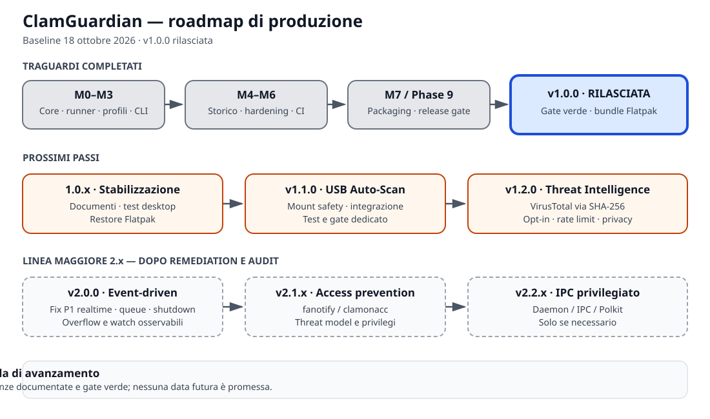

# ClamGuardian Implementation Roadmap

*Last updated: 2026-10-20 — PR #13 merged to `feature` @ `144e89f` (audit P1/P2 remediation closed: clamd AUD-01/AUD-04, quarantine key AUD-02/AUD-03, CI hardening AUD-05/07/13 applied in `a315082`, runtime exposure AUD-06 accepted, intelligence frozen Phase 11). Release engineering for `v1.0.1` is prepared (version, AppStream release, Flatpak manifest pin, `CHANGELOG.md`, `SECURITY.md`, D4 release-gate smoke); the tag is blocked on the manual desktop validation. Local release verification green (350 passed / 8 skipped, mypy 42 files, ruff clean, real clamd EICAR infected exit 1, newline exit 3, `pip-audit` clean, no listener on 8080/8081/15001). Future versions are planning targets, not promised releases or dates.*

This document outlines the authoritative development roadmap for ClamGuardian, tracking completed milestones, in-progress targets, and future architectural phases.

---

## Roadmap Overview



```
M0 → M0.5 → F0 → M1 → M2 → M3 → M4-A → M4-B (B1..B7) [COMPLETED]
    ↓
Phase 1: M4 Profile Propagation [COMPLETED]
Phase 2: M4 Content Hashing [COMPLETED]
Phase 3: M4 Security Test Gap Closure [COMPLETED]
Phase 4: M4 Finalization & Report [COMPLETED]
    ↓
Phase 5: M5 Security Hardening [COMPLETED]
Phase 6: M5 P2 Evaluation [COMPLETED]
Phase 7: M6 CI & Quality Gates [COMPLETED]
Phase 8: M7 Packaging [COMPLETED]
Phase 9: 1.0 Release Gate [COMPLETED 2026-10-16 — tag v1.0.0 @ 8ee8a56, installable Flatpak bundle]
    ↓
1.0.x: Stabilization [CURRENT - documentation, desktop validation, Flatpak restore]
    ↓
Desktop Application (GTK4/Libadwaita) [D1..D4 IMPLEMENTED 2026-10-19 on `feature` — manual desktop validation pending]
    ↓
Phase 10: 1.1 USB Auto-Scan [DEFERRED - out of 1.0 scope]
Phase 11: Threat Intelligence Integration [DEFERRED - out of 1.0 scope]
Phase 12: 2.x-A Event-Driven Monitoring [DEFERRED - out of 1.0 scope]
    ↓
2.x-B / 2.x-C [DEFERRED]
```

---

## Release Status Summary

Future versions are planning targets, not implemented releases or promised dates.

| Status | Milestone | Exit criterion |
|---|---|---|
| **Completed** | `v1.0.0` | Green release gate, bundle produced, promotions documented |
| **Current** | `1.0.x` | Coherent documentation; recorded manual desktop test; Flatpak restore verified — `v1.0.1` prepared, tag blocked on the manual validation (`reports/RELEASE-1.0.1.md`) |
| **Implemented** | Desktop App — Phases D1 + D2 + D3 + D4 | Foundations + diagnostics, Scan page, History, Quarantine, Databases, Diagnostics and Settings; window chrome, About, opt-in notifications, accent stylesheet, default-profile settings, quarantine ingest from scan results — committed on `feature`, CI smoke covers every page |
| **Next** | Manual desktop validation | Recorded on-desktop click-through of the D4 pages (`docs/validation/DESKTOP-TEST-1.0.md`) and Flatpak restore verification |
| **Minor release** | `v1.1.0` | Integrated USB Auto-Scan, target safety, tests and dedicated gate |
| **Minor release** | `v1.2.0` | VirusTotal lookup over SHA-256, opt-in, rate limiting, privacy and tests |
| **Major release** | `v2.0.0` | Reliable realtime after P1 remediation and independent audit |
| **2.x extension** | `v2.1.x` | `fanotify`/`clamonacc` access-prevention evaluation, privileges and threat model |
| **2.x extension** | `v2.2.x` | Privileged service/IPC/Polkit only if justified by a use case |

---

## Completed Milestones

### M0: Repository Initialization
- **Objective:** Establish Python project structure, packaging layout, license, and initial CI setup.
- **Status:** COMPLETED

### M0.5: ClamAV Engine Abstraction
- **Objective:** Implement `BaseAVEngine` interface and `ClamAVEngine` supporting hybrid clamd UNIX socket execution with `clamscan` fallback.
- **Status:** COMPLETED

### F0: Architecture Freeze v1
- **Objective:** Freeze foundational architecture: Core owns scan models, Engine owns ClamAV execution, History owns persistence, UI owns GTK presentation.
- **Status:** COMPLETED

### M1: Asynchronous ScanTaskRunner & Cancellation
- **Objective:** Implement bounded concurrency, queueing, process-group SIGTERM/SIGKILL termination, and cancellation.
- **Status:** COMPLETED

### M2: Profile Infrastructure & Preset Models
- **Objective:** Implement `ScanProfile` model, preset registry (`quick`, `home`, `full`, `custom`), validation, and engine translation.
- **Status:** COMPLETED

### M3: Subprocess Security & Flatpak Host Execution
- **Objective:** Implement safe subprocess execution, arguments translation, process-group isolation, and `flatpak-spawn --host` support.
- **Status:** COMPLETED

### M4-A: History Schema Design & Budgets
- **Objective:** Define history persistence schema v1, budget caps (~8 KiB JSON columns), and data models.
- **Status:** COMPLETED

### M4-B1 → M4-B7: SQLite History Persistence & Subcommands
- **Objective:** Implement `HistoryStore` protocol, `SqliteHistoryStore` backend (WAL, foreign keys, `0o700` dir permissions), CLI subcommands (`history list`, `history show`, `history purge`), and background recording.
- **Status:** COMPLETED

---

## Active & Pending Roadmap Phases

### Phase 1: M4 Profile-Aware History Propagation
- **Status:** COMPLETED
- **Scope:** Ensure scan profile information (`profile_id`, `profile_snapshot`) flows deterministically from Scan Request → ScanProfile → ScanTaskRunner → Engine → ScanResult → History.
- **Dependencies:** M4-B history layer.
- **Evidence:** `docs/reports/M4-FINAL-REPORT.md` (fixes `81ea321`, `88a57a6`).

### Phase 2: M4 Content Hash Model
- **Status:** COMPLETED
- **Scope:** Compute SHA-256 for single-file scan artifacts (`sha256=<digest>`); set `sha256=None` for directory scans.
- **Dependencies:** Phase 1.
- **Evidence:** `docs/reports/M4-FINAL-REPORT.md`; digest now recorded on both engine backends.

### Phase 3: M4 Security Test Gap Closure
- **Status:** COMPLETED
- **Scope:** Audit and add comprehensive tests for Quarantine (ciphertext, corrupted auth, path traversal, TOCTOU), Database updates (checksum mismatch, rollback), Engine (Flatpak host execution), and Filesystem (special files, symlinks, FIFOs, sockets, devices).
- **Dependencies:** Phase 2.
- **Evidence:** `docs/reports/M4-FINAL-REPORT.md`; provider-level digest enforcement tests added. Database digest optionality is an M5 item (see report, section 5).

### Phase 4: M4 Finalization & Report
- **Status:** COMPLETED
- **Scope:** Verify Core/Engine/History boundary isolation, run full quality gates, produce M4 Report.
- **Dependencies:** Phase 3.
- **Evidence:** `docs/reports/M4-FINAL-REPORT.md`; boundaries verified, quality gates green (203 passed / 2 skipped, ruff, mypy on 26 source files).

### Phase 5 & 6: M5 Security Hardening & P2 Evaluation
- **Status:** COMPLETED
- **Scope:** Quarantine streaming/chunked AES-256-GCM encryption, database download integrity, explicit scan target validation (handling special files/symlinks), host execution hardening, intelligence trust boundaries, P2 evaluation.
- **Dependencies:** Phase 4.
- **Evidence:** `docs/reports/M5-HARDENING-REPORT.md`; fixes `3394f86`, `192695c`, `d1a5cb3`, `b21e320`.

### Phase 7: M6 CI & Quality Gates
- **Status:** COMPLETED
- **Scope:** Integrate `mypy` and `pip-audit` into GitHub Actions CI pipeline.
- **Dependencies:** Phase 5 & 6.
- **Evidence:** `docs/reports/M6-CI-GATE-REPORT.md`; dedicated `audit` job on the pinned lockfile (`uv lock --check` + `pip-audit --strict -r`), `test` job on Python 3.11/3.12/3.13. **Closed by execution:** CI run `38493461942` on `9832b4d` — `audit` job green (`pip-audit --strict`: "No known vulnerabilities found"), `test` green on 3.11/3.12/3.13 (247 tests each).

### Phase 8 & 9: M7 Packaging & 1.0 Release Gate
- **Status:** COMPLETED (both) — 2026-10-16
- **Scope:** Desktop metadata, icon, Flatpak manifest, 1.0 release readiness audit & gate.
- **Dependencies:** Phase 7.
- **Evidence:** `docs/reports/M7-PACKAGING-REPORT.md`; `tests/test_packaging.py` (16 tests); wheel built, installed and run end to end; Release Gate CI (`.github/workflows/release-gate.yml`) — 7 jobs on the final tag run `38977065253` (`v1.0.0` @ `8ee8a56`; an earlier green tag run `38975655153` validated `745e1e7`): preflight, GNOME 51 offline Flatpak build (local manifest), AppStream validation, real ClamAV (clamscan + clamd, clean + EICAR), GTK smoke, release-manifest build pinned to the tag, and gate summary — all green. Deliverable: `ClamGuardian-v1.0.0-linux-x86_64.flatpak` (installable bundle, ~4.7 MB). The first tag run failed on a `cffi` cp312 wheel left in the release manifest only (404 on first-ever download of those sources); the fix (`cffi` cp314 in both manifests) shipped in `745e1e7` with two guard tests (manifest parity + runtime platform tags), then the tag was re-pointed to the fixed commit and finally to the release docs commit `8ee8a56`, each position re-validated by a green tag run.
- The checklist, the per-gate evidence and the procedure for each gate live in **`docs/reports/RELEASE-GATE-1.0.md`**.

### 1.0.x: Post-Release Stabilization
- **Status:** CURRENT
- **M1 — Documentation realignment:** verified in this branch: `docs/ROADMAP.md` and `docs/reports/RELEASE-GATE-1.0.md` record tag `v1.0.0` @ `8ee8a56` with the final tag run `38977065253`, while on `origin/main` `docs/ROADMAP.md` still cites `745e1e7` (verified via `git show origin/main:docs/ROADMAP.md`). Realign `README.md`, `docs/ROADMAP.md`, `docs/reports/RELEASE-GATE-1.0.md` and packaging through the normal protected flow `feature → testing → development → main`, never with direct edits to `main`. Prerequisite: compare the current SHAs of all branch tips.
- **M1 goal:** all production documents cite the same tag, commit and evidence run.
- **M1 status (2026-10-20):** release engineering for `1.0.1` prepared — version, AppStream release entry, Flatpak manifest pin, `CHANGELOG.md` (new), `SECURITY.md` (new) and the release checklist `reports/RELEASE-1.0.1.md`; the D4 smoke patch is applied. The bulk rewrite of the 1.0.0 references stays in the tag commit, so the docs never advertise an artifact that does not exist yet.
- **M2 — Manual test on a real desktop:** the CI GTK smoke test passed (Xvfb); a click-through on a real desktop remains the last gate before the `v1.0.1` tag. Verify Flatpak launch, GTK pages, host ClamAV access, clean/EICAR scan in a controlled environment, results/history and database update.
- **M2 status:** **BLOCKED — pending the maintainer's local host.** Execute `docs/validation/DESKTOP-TEST-D4-2026-10-19.md` (14 steps) and record outcomes before any promotion or tag.
- **M2 goal:** repeatable checklist with environment and outcomes recorded. Test template: `docs/validation/DESKTOP-TEST-1.0.md`.
- **M3 — Quarantine restore verification in Flatpak:** the core exposes `QuarantineVault.restore()`, but restoring to arbitrary host paths must be verified inside the sandbox, since `--filesystem=host:ro` may restrict writes. Reproduce the case in the installed app, define the supported destinations, and — only if needed — evaluate a file portal or narrowly scoped writable permissions. Do not broaden Flatpak permissions indiscriminately.
- **M3 status:** **PENDING**, same desktop session as M2 (`DESKTOP-TEST-1.0.md` §8).
- **M3 goal:** restore tested and documented without needlessly weakening the sandbox; if the supported paths already work, record the evidence without superfluous changes.
- **M4 — Dependency and manifest maintenance:** CI, lockfile and offline manifests.
- **Promotion testing:** opening the `feature → testing` promotion PR runs the Release Gate
  workflow, whose `flatpak-local` job uploads an installable test bundle
  (`ClamGuardian-testing-linux-x86_64.flatpak`, 14-day retention). Install and exercise it
  on the host per `docs/validation/DESKTOP-TEST-1.0.md` before merging, so `testing` is
  validated before any further promotion or tag.
- **Gate:** no critical regressions; tests, audit and packaging green. Ship a patch only if actual fixes are needed.
- **Dependencies:** 1.0 Release Gate.

### Desktop Application (GTK4/Libadwaita)

- **Status:** APPROVED 2026-10-18 — implemented on `feature`: Phases D1, D2, D3, D4 (D4 recorded in `docs/validation/DESKTOP-TEST-D4-2026-10-19.md`; manual desktop validation pending). Plan of record: `project/HANDOFF-2026-10-18-DESKTOP-UI.md` (core inventory, constraints, estimates).
- **Reason:** the repository currently has no `Adw.Application`, no main window and no Scan/History/Quarantine/Diagnostics pages; the `.desktop` launcher invokes the CLI headlessly and shows nothing. The maintainer approved building the complete desktop application on the existing UI-ready core (engine, `ShieldTaskController`, profiles, history store, quarantine vault, database pages), styled after the Malwarebytes layout mapped to Libadwaita.
- **Phase D1 — Foundations + Diagnostics:** **IMPLEMENTED 2026-10-18 (`4a37241`)** — headless `core/diagnostics.py` (`run_dependency_checks()` with per-distro remedies, Flatpak-aware binary lookup), CLI `clamguardian doctor [--json]` (exit 6 on critical gaps) + `clamguardian ui`, `Adw.Application` shell with `NavigationSplitView` sidebar (Scan/History/Quarantine placeholders until D2/D3, Databases embedded, Diagnostics real), Diagnostics page (status banner + per-component expanders with per-distro install guides + Recheck), startup auto-dialog when critical dependencies are missing, `.desktop` fixed to `Exec=clamguardian ui`, release-gate GTK smoke extended to app shell + diagnostics page. Local evidence: ruff + mypy green, 279 passed / 2 skipped, live validation on the desktop (healthy path + missing-dependency dialog path). Remaining for closure: CI smoke on the next gate run + maintainer click-through.
- **Phase D2 — Scan page:** **IMPLEMENTED 2026-10-18 (`26abf34`)** — target chooser (folder/file/home), profile dropdown, Scan/Cancel buttons, in-flight state (timer + threat counter), cancel, result cards (clean / infected with per-threat `ActionRow` list / error / cancelled), history recording via `record_scan`; integrated into `MainWindow` shell and the GTK smoke job in `.github/workflows/release-gate.yml`. Gate green (ruff/mypy/pytest).
- **Phase D3 — History + Quarantine pages:** **IMPLEMENTED 2026-10-18 (`5dbd74c`)** — `ui/history_page.py` with status-filter list and limit, detail dialog, purge with `AlertDialog` confirmation; `ui/quarantine_page.py` with entry list, restore (destination dialog) and delete with confirmation; key management via Secret Service with `0600` file fallback in app-data. Tests `tests/test_history_page.py` + `tests/test_quarantine_page.py`. Gate green (ruff/mypy/pytest).
- **Phase D4 — Polish:** accent CSS provider + bundled `data/style.css`, About dialog (AppStream metainfo exists), optional desktop notifications via portal, light settings (default profile). README/desktop-docs realignment, desktop validation checklist update. Estimate: ~200 lines + docs. *(payment-of-record: `project/HANDOFF-2026-10-18-DESKTOP-UI.md`)*
- **Gate per phase:** ruff + mypy + pytest green, CI smoke green, commit to `feature`; commits/pushes per the standing authorization rule.
- **Exit criterion:** installable Flatpak presenting all five pages, diagnostics dialog blocking-on-missing-dependencies at first run, desktop validation recorded.

### Phase 10: 1.1 USB Auto-Scan
- **Status:** DEFERRED (out of 1.0 scope)
- **Scope:** Device/mount detection, target validation, task runner scan triggering for removable media.
- **Dependencies:** 1.0 Release Gate.
- **Note:** An implementation existed on the PR #5 branch and survives in git history — reachable from the annotated tag `audit/pr5-2026-10-12` (tag verified locally). It is not part of the 1.0 branch (nothing in the CLI/UI consumed it) and will be reintroduced with its own gate and call site.
- **Milestones:** M1 Design (device/mount events, deduplication, unmount, failure modes) · M2 Safety (validate mounts and targets; handle disconnections and unsupported targets) · M3 Integration (wire the trigger into `ScanTaskRunner` through a real call site) · M4 Test (mount/unmount, double event, cancellation, missing device) · M5 Gate (core regression, controlled tests, packaging, documentation).
- **Exit criterion:** controlled USB scanning with an explicit policy and no regression of manual scans.

### Phase 11: Threat Intelligence Integration
- **Status:** DEFERRED (out of 1.0 scope)
- **Scope:** Explicit VirusTotal SHA-256 lookup integration using content-hash seam, with opt-in policy and rate limiting.
- **Dependencies:** Phase 10.
- **Note:** The `clamguardian.intelligence` package is present on the 1.0 branch but **unwired**: nothing in the CLI or UI imports it, and no distribution declares the `clamguardian.threat_providers` entry-point group it discovers, so it is not reachable in the 1.0 release. The Core seam `BaseThreatProvider` (`core/base.py`) is the extension contract. The phase returns with its own call site and gate.
- **Milestones:** M1 Privacy (explicit opt-in, clarity on which hashes are sent) · M2 Provider (wire `BaseThreatProvider` into the application flow; implement VirusTotal SHA-256 lookup) · M3 Resilience (rate limiting, timeouts, network failures, offline behaviour) · M4 Trust boundary (remote verdict kept separate from the local ClamAV result) · M5 Test/gate (mocked provider, opt-in, no network access when disabled).
- **Exit criterion:** optional hash-only lookup with the remote result kept separate from the local antivirus verdict. No file upload without an explicit decision.

### Phase 12: 2.x-A Event-Driven Monitoring
- **Status:** DEFERRED (out of 1.0 scope)
- **Scope:** Linux `inotify` monitoring module (`clamguardian/realtime/`), event normalization, debouncing, deduplication, and task runner orchestration.
- **Dependencies:** Phase 11.
- **Note:** The `clamguardian/realtime` package is not part of the 1.0 branch: it is unwired and still carries open P1 defects (duplicate dispatch, queue bound, shutdown, stale watches, silent inotify overflow). It returns with the remediation tracked in the PR #5 audit report (archived under the annotated tag `audit/pr5-2026-10-12`, verified locally).
- **Milestones:** M1 Remediation design (events, queues, dedup, backpressure, shutdown, watch state) · M2 P1 fixes (reproducible regression test per defect: duplicate dispatch, queue limits, shutdown, stale watches, silent inotify overflow) · M3 Observability (overflow, errors and coverage loss made explicit) · M4 Integration (existing runner, concurrency limits, cancellation) · M5 Independent audit (post-implementation read-only review) · M6 Gate (controlled stress, lifecycle, restart, core regression).
- **Exit criterion:** bounded and observable monitoring; no release before verified closure of the P1 defects.

---

## Deferred Phases (Out of Scope for 2.x-A)

### 2.x-B: Access Prevention (fanotify / clamonacc)
- **Status:** DEFERRED
- **Reason:** Requires architectural review of root privileges / on-access blocking.
- **Milestones:** privilege threat model and architecture; `fanotify`/`clamonacc` evaluation, fail-open/fail-closed and recovery; compatibility, blocking and degradation tests.
- **Exit criterion:** on-access feature only with security boundaries and a dedicated gate; subordinate to 2.0 stability.
- **Dependencies:** v2.0.0.

### 2.x-C: Privileged IPC Service / Daemon / Polkit
- **Status:** DEFERRED
- **Reason:** Requires separate system security architecture decision.
- **Milestones:** separate architectural decision; minimal IPC API, authentication/authorization, input validation and abuse testing; verify whether the existing one-shot execution is insufficient.
- **Exit criterion:** introduce daemon/Polkit only if the use case justifies the added cost and risk.
- **Dependencies:** v2.0.0 stability; v2.1.x where applicable.

---

## Recommended Work Order

1. **Now (blocked):** manual desktop validation of Desktop Application Phase D4 on `feature` (click-through checklist, Flatpak restore). Plan of record: `project/HANDOFF-2026-10-18-DESKTOP-UI.md`; release checklist: `reports/RELEASE-1.0.1.md`. The release engineering for `1.0.1` is already prepared and waits for this record.
2. **Then:** merge `feature` → `testing` once the manual validation is recorded, promote `testing → development → main`, tag `v1.0.1` and publish the GitHub Release with the Flatpak bundle.
3. **After:** `1.1.0` USB Auto-Scan.
4. **Then:** `1.2.0` Threat Intelligence.
5. **Only after remediation and audit:** `2.0.0` realtime.
6. **After 2.0 stability:** `2.1.x` access prevention.
7. **Last, and only if needed:** `2.2.x` privileged service/IPC.

This order keeps the project sustainable for a single maintainer and avoids prematurely turning ClamGuardian into an overly broad EDR.

## Working Rules

- Verify branch, SHAs, working tree, remotes and CI before every task.
- No automatic commit, push, merge, tag or PR without explicit authorization.
- Never rewrite the `v1.0.0` tag; no destructive resets or operations overwriting local changes.
- Stop if the baseline is unexpected or a command fails.
- Every milestone needs a measurable goal, reproducible tests, evidence, known limits and an exit criterion.
- Code not wired to a real call site and not covered by the gate is not a completed feature.
- No fictitious dates for future releases: ship when the gate is green.
- Branch policy (rulesets, 2026-10-19): `main` is governed only by the `main-protection`
  ruleset (id `25427935`, enforcement `active`, target `refs/heads/main`); classic branch
  protection on `main` was removed to avoid double enforcement. Rules: PR required before
  merging with `required_approving_review_count: 0` (solo-maintainer: no self-approval
  deadlock), `required_review_thread_resolution: true`, `deletion` + `non_fast_forward`
  blocked, `bypass_actors: []` (nobody bypasses). No `required_status_checks` pinned yet —
  add CI checks to the ruleset only after validating exact check names + integration_id.
  Promotion flow: `feature` (unprotected) → PR → `testing`/`development` (count 0) → PR →
  `main` (ruleset).
